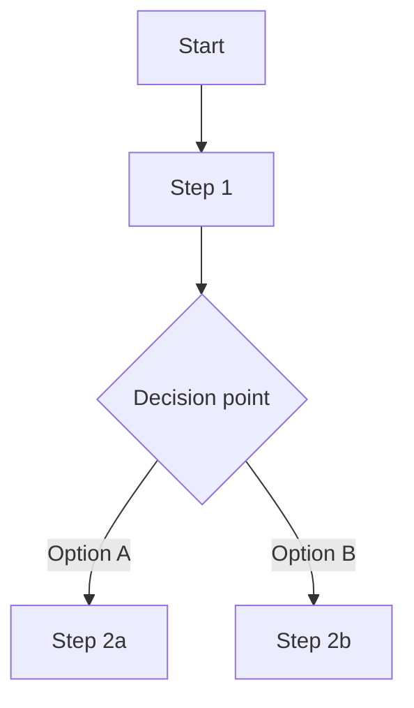

# Plan template and examples

Read this when wording clarifying questions (phase 2) or writing the plan (phase 3).

## Clarifying questions: example

```
Before I build the plan, a couple of quick questions:

1. Should this budget cover the whole household, or only your own spending?
2. Do you want a new sheet beside last year's, or should it replace it?
```

## Plan template

```markdown
# Plan: [Task name]
**Date:** YYYY-MM-DD
**Where:** [Areas/<Area> / Projects/<Project> / HQ / System]
**Status:** AWAITING APPROVAL

---

## Goal
[One clear sentence: what does "done" look like?]

## Scope
- **In:** [what this plan covers]
- **Out:** [what is explicitly excluded, so scope does not creep]

## Steps
- [ ] 1. **[Step name]**: [one-line description]
  - Detail: [what exactly happens]
  - Files: [file paths to create or edit]
- [ ] 2. **[Step name]**: [one-line description]
  - Detail: ...
  - Files: ...
- [ ] 3. ...

*(Add sub-steps under any step that has more than one action.)*

## Files affected
| File | Action | Reason |
|------|--------|--------|
| path/to/file.md | Create / Edit / Move / Delete | Why this file is touched |

## Risks and dependencies
- [Any risk, blocker or dependency worth flagging, e.g. "Requires the T705 drive to be connected"]

---

> ✋ **Awaiting your approval.**
> Reply with **"approved"**, **"build"** or **"go ahead"** to start execution.
> To change anything (steps, scope, approach), say what to adjust and I'll revise the plan.
```

## Branching flows

For tasks with branching logic or flows across workstations, add a Mermaid diagram below the steps:


