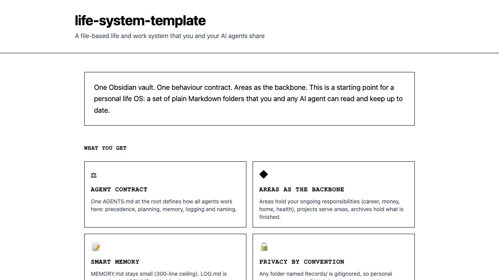
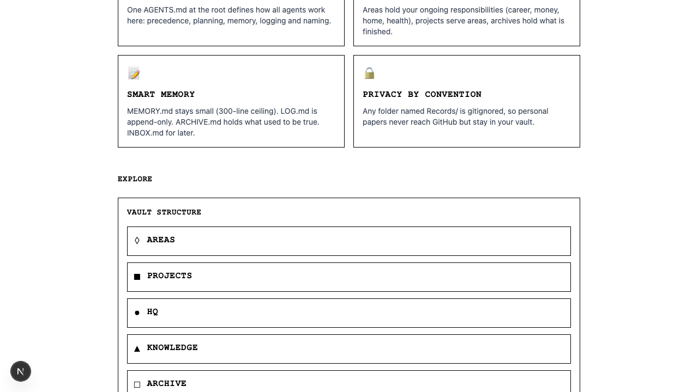
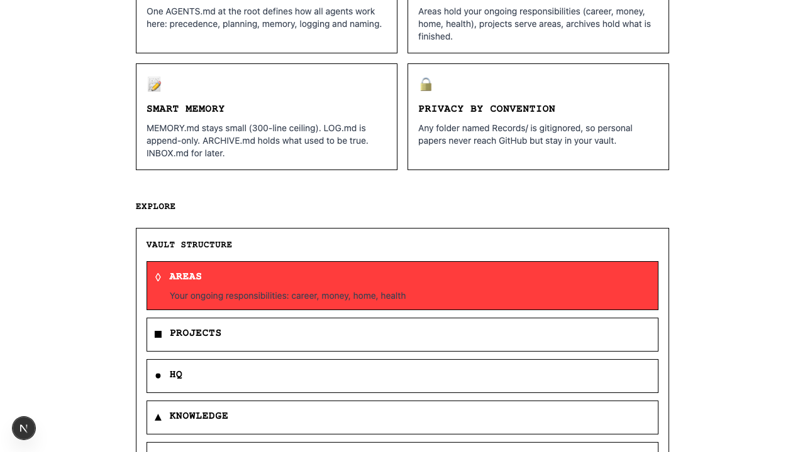
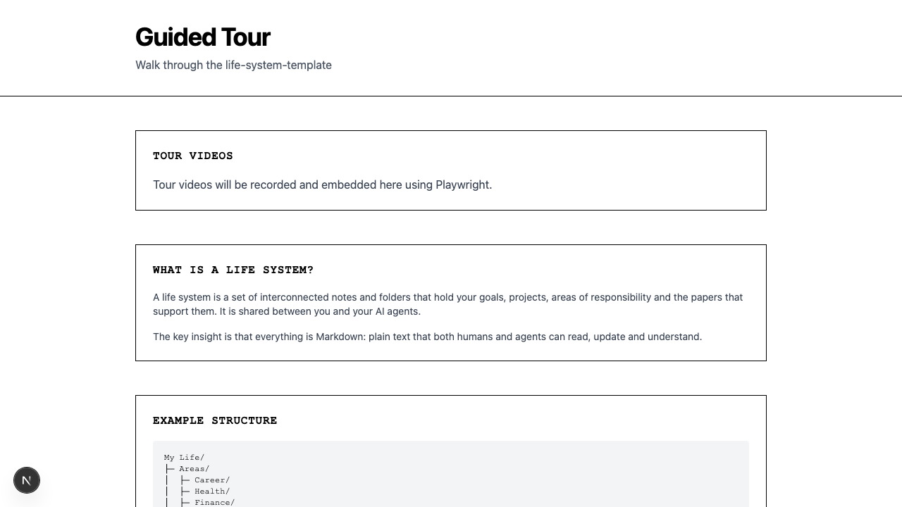
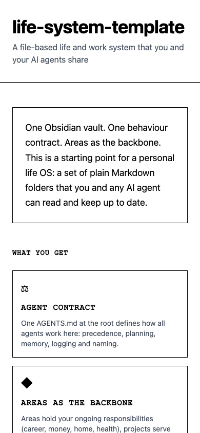
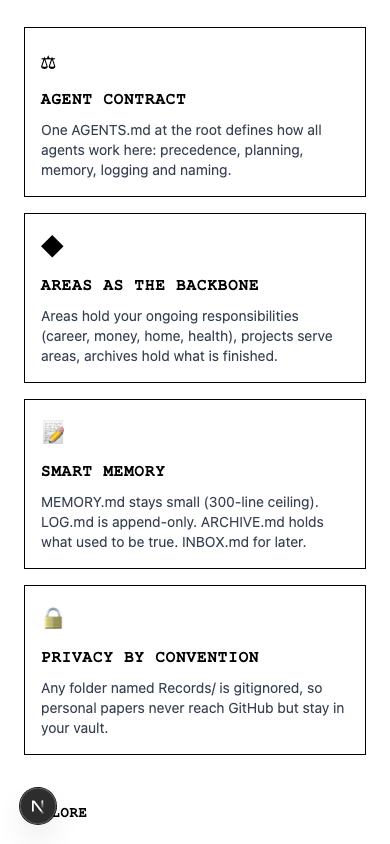
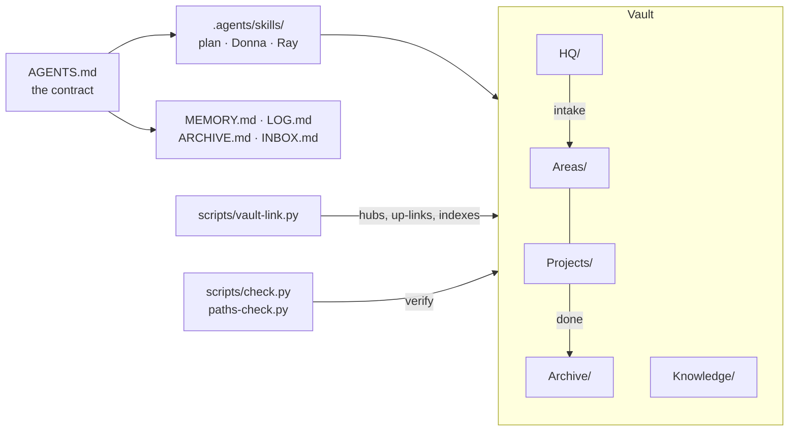

<div align="center">

# life-system-template

**A file-based life and work system that you and your AI agents share: one Obsidian vault, one behaviour contract, areas as the backbone.**

[](https://github.com/rNLKJA/life-system-template/actions/workflows/ci.yml)
[](LICENSE)

**Live demo:** [life-system-template.vercel.app](https://life-system-template.vercel.app)

</div>

## Showcase

[Take the guided tour](https://life-system-template.vercel.app/tour): screenshots and walkthroughs of the landing page, features, interactive vault navigator, and mobile responsive design.

| | |
| --- | --- |
| <br>**Landing page.** Introduction to the system and key benefits. | <br>**Features.** Agent contract, Areas as the backbone, Smart memory, Privacy. |
| <br>**Interactive explorer.** Expand vault folders to see their descriptions. | <br>**Guided tour.** Screenshots and walkthroughs. |
| <br>**Mobile responsive.** The site works on small screens. | <br>**Mobile features.** Responsive layout at 390px width. |

## What you get

This is a starting point for a personal "life OS". It is a set of plain Markdown folders that you, and any agent you work with (Claude Code, Codex, Cursor, Cowork, Copilot), can read and keep up to date.

- **One contract for every agent.** `AGENTS.md` at the root says how agents work here: precedence, when to plan first, memory, logging, routing and naming. Every harness reads it, and there is no second copy to drift.
- **Areas as the backbone.**
  - `Areas/` holds your ongoing responsibilities: career, money, home, health.
  - `Projects/` holds time-bound projects, each tagged with the area it serves.
  - `Archive/` holds whatever is finished.
  - `HQ/` holds goals, reviews, your agents' homes and an intake tray for new papers.
- **Memory that stays small.** `MEMORY.md` holds what is true now (300-line ceiling), `LOG.md` what happened (append-only), `ARCHIVE.md` what used to be true, and `INBOX.md` what to deal with later. Every project and role keeps its own pair.
- **Privacy by convention.** Any folder named `Records/` is gitignored, so papers never reach GitHub, including the papers of an area you add next year.
- **A graph that shows meaning, not plumbing.** Every note links to its nearest hub. Folder indexes, system files and machine-written feeds are hidden from Obsidian's graph by a filter that ships with the vault.
- **Checks that keep it honest.**
  - `scripts/check.py` verifies the structure.
  - `scripts/paths-check.py` fails when a skill or an `AGENTS.md` names a folder that no longer exists.
  - `scripts/selftest.sh` proves the whole template works from a clean copy.

## Quick start

You need Python 3.9 or later and git. Obsidian is optional but recommended.

```bash
git clone https://github.com/<you>/life-system-template "My Life"
cd "My Life"
python3 scripts/init.py
python3 scripts/check.py    # expect 0 FAIL
```

Then open the folder as a vault in Obsidian, and start an agent session in the same folder. If the vault will hold anything personal, keep the repository private.

## About this site

The web app is built with Next.js 16, TypeScript, Tailwind and React. It showcases the template with:

- Interactive vault navigator to explore the system structure
- Landing page explaining the core concepts
- Responsive design (mobile, tablet, desktop)
- /tour page with guided screenshots
- Component tests with Vitest
- CI workflow: lint, typecheck, test, build

To run locally:

```bash
cd web
npm install --legacy-peer-deps
npm run dev          # Start at http://localhost:3870
npm test             # Run tests
npm run build        # Production build
```

Screenshots are generated by Playwright tests in `web/scripts/showcase/`.

## How it fits together



## Using it with your agents

- **Claude Code, Codex and Cursor:** open this folder. `AGENTS.md` loads on its own. Skills come from `.agents/skills/`, which `.claude/skills` links to. In Claude Code, a guard hook asks before anything is deleted and keeps `LOG.md` append-only.
- **Cowork and claude.ai:** upload each skill folder as a zip under Customize, Skills. Connect this folder to the session, and paste the short global instruction from [Skills and paths](original/Resources/system/skills-and-paths.md).

## Guides

- [How to write AGENTS.md](original/Resources/system/agents-md.md): what goes in, what stays out, and how to write rules agents follow.
- [MEMORY, LOG, ARCHIVE and INBOX](original/Resources/system/memory-and-log.md): the placement test, the 300-line ceiling, the append-only log.
- [Obsidian display](original/Resources/system/obsidian.md): hubs, indexes and feeds, the graph filter term by term, and how to keep the graph lean.
- [Skills and paths](original/Resources/system/skills-and-paths.md): skill anatomy, why paths go wrong in each harness, and setting up Cowork and claude.ai.

## Credits and licence

This is the generic version of a structure I use every day, with every personal detail taken out. MIT licence; see `LICENSE`.

Built with [Claude Code](https://claude.com/claude-code).
