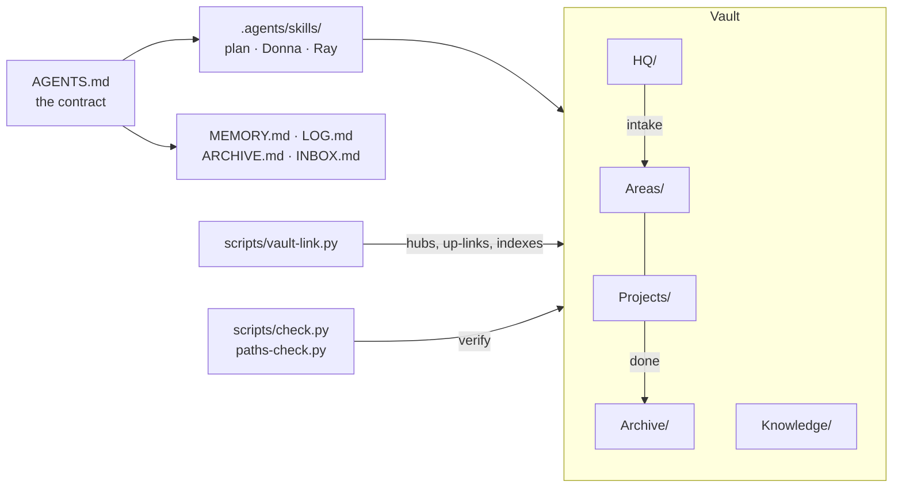

<div align="center">

# life-system-template

**A file-based life and work system that you and your AI agents share: one Obsidian vault, one behaviour contract, areas as the backbone.**


</div>

This is a starting point for a personal "life OS". It is a set of plain Markdown folders that you, and any agent you work with (Claude Code, Codex, Cursor, Cowork, Copilot), can read and keep up to date. It is the generic version of a structure used daily, with every personal detail taken out.

## What you get

- **One contract for every agent.** `AGENTS.md` at the root says how agents work here: precedence, when to plan first, memory, logging, routing and naming. Every harness reads it, and there is no second copy to drift.
- **Areas as the backbone.**
  - `Areas/` holds your ongoing responsibilities: career, money, home, health.
  - `Projects/` holds time-bound projects, each tagged with the area it serves.
  - `Archive/` holds whatever is finished.
  - `HQ/` holds goals, reviews, your agents' homes and an intake tray for new papers.
- **Memory that stays small.** `MEMORY.md` holds what is true now (300-line ceiling), `LOG.md` what happened (append-only), `ARCHIVE.md` what used to be true, and `INBOX.md` what to deal with later. Every project and role keeps its own pair.
- **Privacy by convention.** Any folder named `Records/` is gitignored, so papers never reach GitHub, including the papers of an area you add next year.
- **A graph that shows meaning, not plumbing.** Every note links to its nearest hub. Folder indexes, system files and machine-written feeds are hidden from Obsidian's graph by a filter that ships with the vault. In a real vault built this way, that cut the graph from 643 nodes to 232 without deleting anything.
- **Checks that keep it honest.**
  - `scripts/check.py` verifies the structure.
  - `scripts/paths-check.py` fails when a skill or an `AGENTS.md` names a folder that no longer exists.
  - `scripts/selftest.sh` proves the whole template works from a clean copy.
- **Three skills.**
  - `plan`, for anything hard to undo.
  - Two optional roles:
    - **Donna**, a chief of staff for dates, deadlines and people.
    - **Ray**, a growth coach for positioning, the market and accountability.

## Quick start

You need Python 3.9 or later and git. Obsidian is optional but recommended.

```bash
git clone https://github.com/<you>/life-system-template "My Life"   # or "Use this template" on GitHub
cd "My Life"
python3 scripts/init.py           # your name, time zone, spelling and areas
python3 scripts/vault-link.py     # wires hubs, up-links and folder indexes
python3 scripts/check.py          # expect 0 FAIL
```

Then open the folder as a vault in Obsidian, and start an agent session in the same folder. If the vault will hold anything personal, keep the repository private.

`init.py` can also rename the top-level folders, for example `--rename projects="Project Desk"`, and leave out the two roles with `--no-roles`. Run `python3 scripts/init.py --help` for every option.

## How it fits together



| Folder | Holds |
|---|---|
| `Areas/` | One folder per ongoing responsibility, each with a hub note (`type: area`) and a private `Records/` |
| `Projects/` | Time-bound projects: hub (goal, scope, `area:`), `TASKS.md`, `MEMORY.md`, `LOG.md`; the live list in `Projects/MEMORY.md` |
| `HQ/` | Goals and reviews, the role homes (`Donna/`, `Ray/`), and `Intake/` for papers not yet filed |
| `Knowledge/` | One idea per note, with its source |
| `Archive/` | Finished projects, old papers by area, old code |
| `Resources/` | Note templates, the project kit, and the guides in `Resources/system/` |
| `Scratch/` | Working files; never synced, never searched |
| `scripts/` | The tooling below |

## Everyday use

| To... | Run or do |
|---|---|
| Capture a thought | add a dated line to `INBOX.md` |
| Add an area | `python3 scripts/new-area.py "Pets" --records` |
| Start a project | `python3 scripts/new-project.py "Kitchen renovation" --area Home --next "Get three quotes"` |
| Refresh links and indexes after filing or moving | `python3 scripts/vault-link.py` |
| Check the structure | `python3 scripts/check.py` |
| See what the graph shows | `python3 scripts/graph-report.py` |
| Check that skills and prompts name real folders | `python3 scripts/paths-check.py` |

## Guides

- [How to write AGENTS.md](Resources/system/agents-md.md): what goes in, what stays out, and how to write rules agents follow.
- [MEMORY, LOG, ARCHIVE and INBOX](Resources/system/memory-and-log.md): the placement test, the 300-line ceiling, the append-only log.
- [Obsidian display](Resources/system/obsidian.md): hubs, indexes and feeds, the graph filter term by term, and how to keep the graph lean.
- [Skills and paths](Resources/system/skills-and-paths.md): skill anatomy, why paths go wrong in each harness, and setting up Cowork and claude.ai.

## Using it with your agents

- **Claude Code, Codex and Cursor:** open this folder. `AGENTS.md` loads on its own. Skills come from `.agents/skills/`, which `.claude/skills` links to. In Claude Code, a guard hook asks before anything is deleted and keeps `LOG.md` append-only.
- **Cowork and claude.ai:** upload each skill folder as a zip under Customize, Skills. Connect this folder to the session, and paste the short global instruction from [Skills and paths](Resources/system/skills-and-paths.md).

## FAQ

**Why AGENTS.md and not CLAUDE.md?** Every harness reads `AGENTS.md`. Claude Code reads `CLAUDE.md` instead when one exists, so keeping both means two contracts that drift apart. `check.py` fails if a root `CLAUDE.md` appears.

**Why hide folder indexes from the graph?** They are navigation, not meaning. A vault of a few hundred notes can easily hold two hundred folder notes and a hundred and fifty system files. Each note still links to its nearest hub, so nothing floats free when they are hidden. Clear the filter whenever you want to see everything.

**Can I rename the folders?** Yes. Run `init.py --rename` while you set up, or later edit `workspace.json` and the paths that name the folder, then run `paths-check.py`, which lists any path you missed.

**Is my data private?** Everything in a `Records/` folder, the intake tray, `Scratch/` and archived code is gitignored. Everything else is committed. Keep the repository private if your notes are personal, and run `git status` before your first push.

## Credits and licence

Adapted from Rin Huang's life-system vault. MIT licence; see `LICENSE`.
