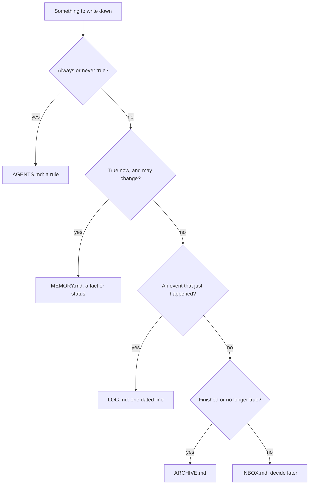

# MEMORY, LOG, ARCHIVE and INBOX

Four plain files carry everything agents need to remember between sessions. Each has one job, and keeping the jobs apart is what keeps every file small and current.

## Contents

- The four files at a glance
- The placement test
- MEMORY.md: what is true now
- LOG.md: what happened
- ARCHIVE.md: what used to be true
- INBOX.md: what to deal with later
- The same pair in every project and role
- Mistakes that make memory rot

## The four files at a glance

| File | Holds | Written | Read |
|---|---|---|---|
| `MEMORY.md` | facts and status that are true now | edited in place | at the start of every session |
| `LOG.md` | one line per meaningful action | appended only, never edited | when you need the history |
| `ARCHIVE.md` | facts and rows that stopped being current | appended | only when asked about the past |
| `INBOX.md` | thoughts to process later | appended, then cleared at review | at the weekly review |

## The placement test

## MEMORY.md: what is true now

- **One or two sentences per entry,** grouped under a few headings: Active projects (a pointer only), Scheduled tasks, Core memory.
- **Hard ceiling of 300 lines.** `scripts/check.py` warns from 240. Past that, agents skim and miss things. When the file approaches it, move dormant entries to `ARCHIVE.md`.
- **Facts, not instructions.** "Tax return due 31 October" is memory; "always lodge before the 25th" is a rule for `AGENTS.md`.
- **One source of truth per fact.** The project table lives only in `Projects/MEMORY.md`; the root `MEMORY.md` points to it. Two copies of one table drift within weeks.
- **Date your changes.** Bump "Last updated" on every edit, and give status lines a date ("waiting on the bank, 2026-10-02"), so a stale line looks stale.

A good entry:

> **Car:** registration renews 14 March; insurance with CGU, renews 2 July. Papers in `Areas/Home/Records/`.

A bad entry, which mixes a rule, a story and a fact:

> Remember to always check the car stuff early because last year it lapsed and that was a pain, rego is in March I think.

## LOG.md: what happened

- **Append-only.** Never edit or delete a line; correct a mistake with a new line. The log is the audit trail, so rewriting it destroys the one record you can trust. In Claude Code the guard hook blocks overwrites; append with `>>`.
- **One line each, in one form:** `YYYY-MM-DD HH:MM [TZ] what happened`, with the outcome and where it landed. For example: `2026-10-05 21:40 [ACDT] Filed 3 payslips into Areas/Career & Work/Records/Employment; vault-link run`.
- **Meaningful actions only:** a decision, a file created, moved or archived, a structural change, a commitment made. Not every read or search.
- **Per folder as well.** Work inside a project, workstream or role home also appends to that folder's `LOG.md`, so each one carries its own history.

## ARCHIVE.md: what used to be true

Move an entry here when it stops being current: a finished project's row, a superseded decision, an old address. Keep the original wording and add the date it moved. Agents do not read `ARCHIVE.md` at session start, which is exactly why moving things here keeps sessions cheap.

## INBOX.md: what to deal with later

Quick capture for anything that has no home yet: one dated line each. At the weekly review, route every line (to a project's `TASKS.md`, an area, `Knowledge/`, or the bin), then delete it from the inbox. An inbox that is never emptied becomes a second, worse memory file.

## The same pair in every project and role

Every project, area workstream and role home keeps its own `MEMORY.md` and `LOG.md`, with the same rules and the same 300-line ceiling. Start a session on a project by reading its `MEMORY.md`, and end it with a line in its `LOG.md`. A folder with its own `MEMORY.md` is also a hub in the Obsidian graph (`Resources/system/obsidian.md`).

## Mistakes that make memory rot

- **A second copy of a table "for convenience".** Point to the one source instead.
- **Editorial in MEMORY.md** ("this project is going badly because..."). Put the judgement in a review note, and keep the fact in memory.
- **Instructions in MEMORY.md.** Agents treat memory as facts, so a rule there is followed inconsistently. Move it to `AGENTS.md`.
- **Using LOG.md as memory.** If an agent must read 200 log lines to learn the current state, the state belongs in `MEMORY.md`.
- **Never archiving.** A 600-line memory file is read partially, which is worse than not at all.
